<p align="center">
  
</p>

# FielDes

**Field-driven design.** A scriptable design and analysis workbench in which every shape, every
analysis result and every design parameter is a *field* — a value at every point in space — so that
**anything can drive anything**: a stress field sets the density of a lattice, a regression over test data
sets a wall thickness, a temperature field thickens a fin, a point you drag moves a whole swelling of a plate.

<p align="center">
  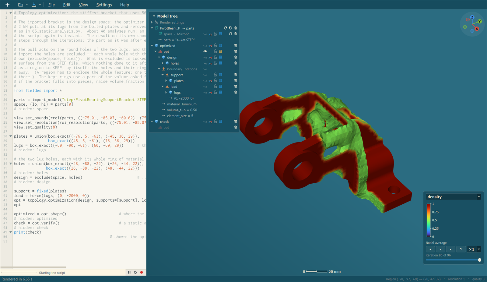
  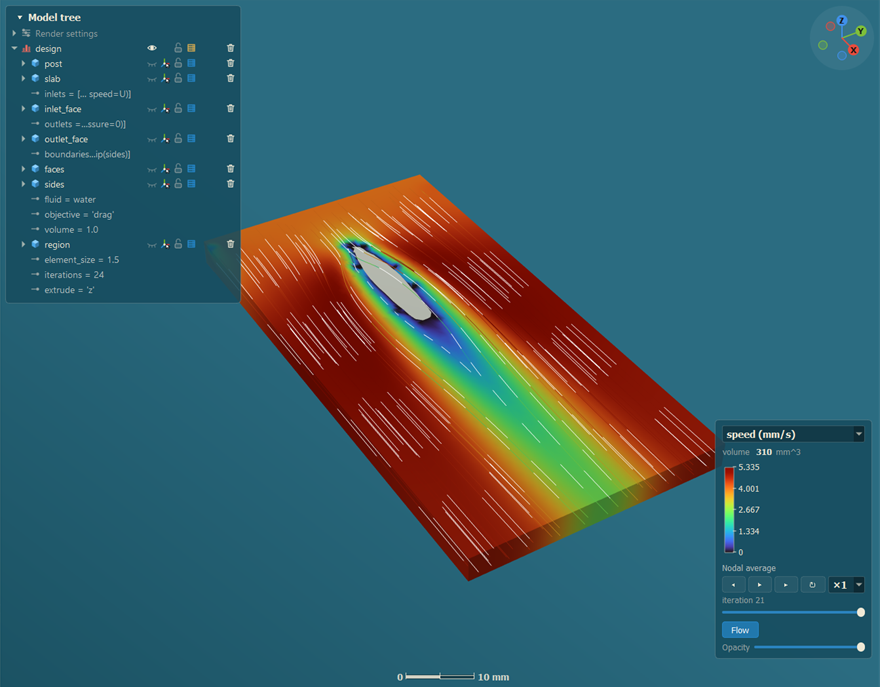
  <br>
  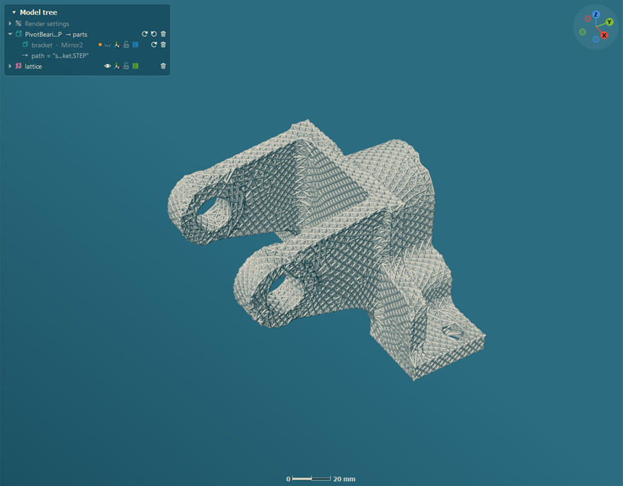
  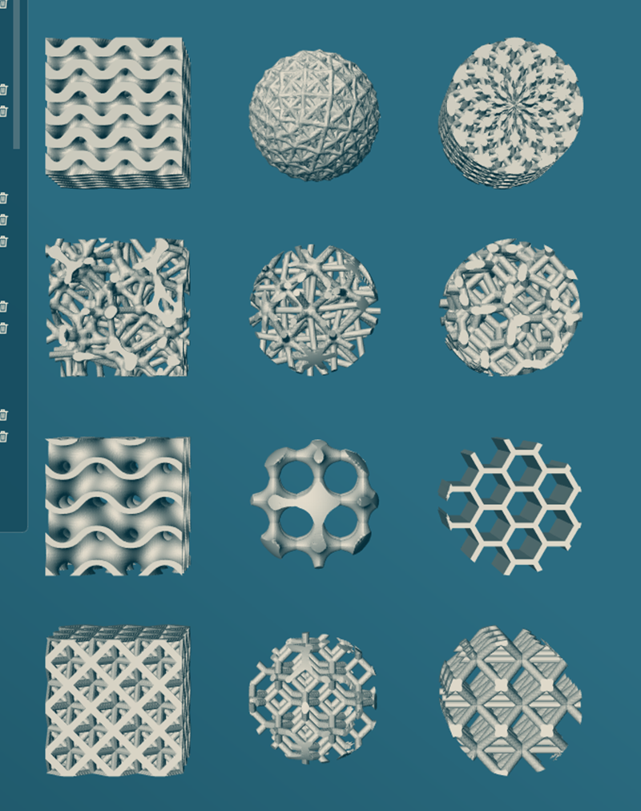
  <br>
  <sub>A bracket made stiffest in half the material &middot; water round a post, reshaped for the least drag &middot; a lattice that fills the walls of a whole part &middot; twelve lattices. Every one is a few lines of script.</sub>
</p>

Wherever a number goes in FielDes, **a field goes**: `offset(part, 1.0)` grows a part by a millimetre everywhere;
`offset(part, ramp(distance_to_point(anchor), (0, 60), (4.0, 0.3)))` grows it by 4 mm near the anchor and 0.3 mm far from
it. The two are written alike, and the field is evaluated exactly where it is needed — never sampled onto a grid.

FielDes models with implicit functions (signed distance fields), imports real CAD (STEP) by
rebuilding it as fields, runs finite-element analyses on the result, and keeps the script and the
viewport in step: every button in the viewport edits the script, and every edit of the script re-renders
the viewport.

<p align="center">
  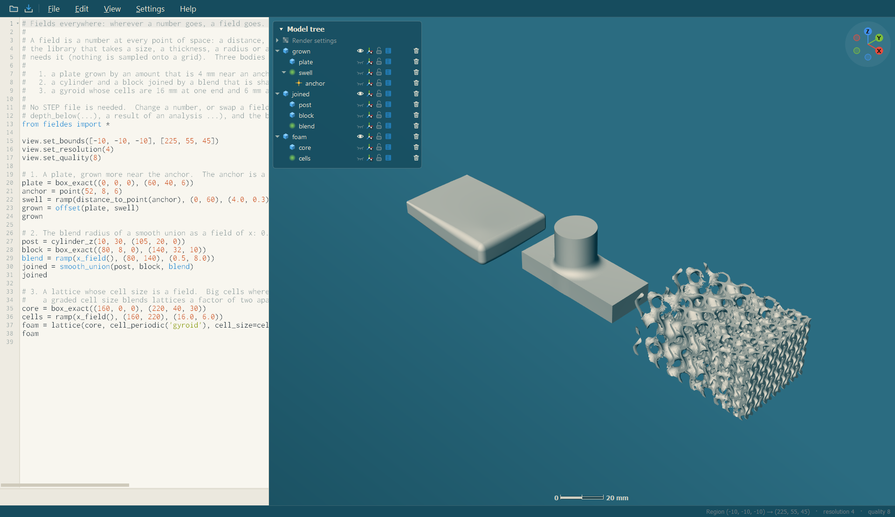
</p>

## The idea

- **The script is the model.** What you see is what a Python script says. Every drag and every button in the viewport is an
  edit of that script — readable, undoable, shareable.
- **Everything is a field.** Shapes, distances, ramps, noise, temperatures, the stress of an analysis: numbers at every point,
  combined with ordinary arithmetic. Any of them can stand where a number stands.
- **Direct manipulation, written down.** Pull a surface or a gizmo: the numbers in the script change. Edit a number: the
  viewport follows.
- **Your own building blocks.** A function in a file of the blocks folder is there in every script, with completion, call
  tips and a place in the menus.

New here? A welcome card offers a **guided tour** the first time FielDes starts (**Help → Guided tour** any time after): short cards over the
program itself that point at what they talk about and let you try it. The [tutorial](docs/tutorial.md) is the written version. **File → Open example file** has 33 scripts; `26` to `31` open at once, the analyses take seconds to minutes (the [examples README](examples/README.md) says how long each takes).

## What it does

| | |
|---|---|
| **Fields everywhere** | Every size, radius, thickness, spacing and blend of every function takes a field instead of a number; so do the properties and loads of an analysis (`Material(E=field)`, `force(..., profile=field)`, a convection coefficient). Lattices have a graded cell size. [How it works](docs/fields.md#fields-everywhere) |
| **A typed, nested model tree** | Every kind of thing — 3D shape, 2D shape, field, surface, point, simulation, material, conditions, lattice, lattice cell, point set — has its own colour and icon. The models an operation is made of are its children, **and nesting always edits the call**: drag a row onto an operation to make it an input, out of one to take it out, between its children to reorder them; a model used twice has a half-transparent **shadow** row at its other use; `Ctrl`+drag adds a reference without moving the model. [The tree](docs/interface.md#the-model-tree) |
| **Make things from the context menu** | Right-click: *Import model...*, *Primitives* (*New 3D shape / 2D shape / 1D shape / point / surface / field*, the most basic of each), *Parametric shapes* (a rounded box, a ring, noise, low-level logic, custom blocks) and *Operations* (which holds *Lattice*) and *Engineering* (a category for each domain, *Structural / Thermal / Fluid*, which holds *New support or load / thermal condition / flow condition / fluid* and the analyses, and *New material* — materials and conditions are models of their own kind: drag one -- or several, selected together -- onto an analysis and they go in the input of their kind: `material=`, `supports=`, `inlets=` ... — then the analyses of a model) — each writes script where you clicked. *low_level_field* and *low_level_body* write a function of x, y and z for you to put your own logic in. On a model it offers the same *Operations* (offsets, moving, **field math**, ...) and *Engineering* (static, modal, topology optimization, thermal, flow, each with a placeholder for every kind of boundary condition it takes; and the materials and conditions to make), written with that model as an argument. The same menu opens on a **line of the script** and on a **row of the model tree**. |
| **Fields you can see** | A field is not a body, so it is not drawn: it is **an icon in the viewport with its name over it**, where the object it was made from is (an eye in the tree shows or hides it). Click the icon -- or select the field in the tree -- and its **field viewer** opens: a disc of the field, coloured by its value at every point, with a radius slider and arrows to move it (drag the icon to place it elsewhere; a menu chooses among several open fields). Arithmetic works on fields as it does on numbers (`a * b`, `2 ** a`, ...), and `field_from_body(body)` turns a body into a field you may multiply freely. |
| **Custom blocks** | A few lines in a file of the blocks folder make a function that is in every script — completion, call tips, menu entries, hot reload. [Custom blocks](docs/blocks.md) |
| **Apps for everyone else** | An engineer declares the inputs of a script (`app.number`, `app.file`, `app.save_as`, ...) and exports it as **one `.fieldesapp` file**; whoever double-clicks it sees **a form, a Run button, a log and the files that were made** — no editor, no code. It runs without a window too (`FielDes run tool.fieldesapp --Radius 7`) and, with Watch, runs again by itself when an input file changes. [Apps](docs/apps.md) |
| **Model with fields** | Primitives, CSG, smooth and chamfered booleans, offsets, shells, twists, bends, repeats, extrusions, revolves, helical and free-form surfaces — all of them fields, composable with ordinary arithmetic. |
| **Import a model** | `import_model()` reads a STEP file or a mesh and chooses for each part: a part mostly of planes and cylinders is **reconstructed**, a part with more than a tenth of its surface free-form (or a surface body) is **tessellated** (see below). Reconstructed, every solid is rebuilt from its faces as a field: planes, cylinders, cones, spheres and tori exactly, **free-form (B-spline) faces by fitted closed-form surfaces**, with the deviation from the CAD reported and painted on the model. Assemblies arrive assembled, each part in its own units. |
| **Parts that are all free-form** | `tessellate()` fits nothing: every solid is tessellated straight from its faces (on all threads, kept next to the file) and the triangles are made the exact signed distance field — for gears, worms, threads and sculpted bodies the fitted surfaces do not follow. Meshing it takes 0.5 to 2.8 times as long as the main importer's formulas. |
| **Exact where it matters** | `exclude()` (or `auto_exclude=True` on the import) locks a region of a shape against everything done to it afterwards; for a STEP part the locked field is the file's *own* surface, meshed straight from the B-rep and made a field, wherever the fit is poor. It works on every shape and every field. |
| **Edit by dragging** | A gizmo (`gizmo()`: move, rotate, scale), handles on any surface of a shape or imported part (`handles()`), and `var()` numbers — what you drag is written back into the script. Every primitive (box, sphere, cylinder, cone, torus, pyramid, prism, rounded box, and the flat circle, rectangle, ring, polygon and triangle) has handles that move the face you pull and no other. |
| **Python, as it is** | The script is plain Python and the model tree shows it: an `if`, a loop, `with`, `try`, a function or a class is a row, with the variables and statements in it under it (locked there: the code is edited in the editor), and a block moves by drag. The context menu has a **Python** category of 15 basic blocks. What you add from the tree goes to the **insertion point** -- click between two rows -- which follows the text cursor of the editor. `Ctrl+E` extrudes the selected 2D shape. [Python in the tree](docs/interface.md#python-in-the-tree) |
| **Shapes from points** | Points are models of their own. A **profile** is the 2D shape a closed outline through points encloses (corners, or spline points with `smooth=True`); `extrude` pulls it into a solid and `path_extrude` sweeps it along a `spline` (the scale of a point is how thick the sweep is there). Press an edge and drag to pull a point out of it; double-click a point to switch it between a corner and a spline point. A **work plane** (`Shift+W`) is a grid to draw lines, splines and points on, in any plane. [Profiles](docs/profiles.md) |
| **Copies and linked copies** | `Shift+D` copies a model. `Ctrl+D` **links** it: `bolt_2 = instance(bolt)` is the bolt itself, follows every change of it and can only be moved and rotated; the bolt is held by a shadow reference and keeps its own row. [Copies](docs/handles.md#copies-shiftd-and-ctrld) |
| **Analyse** | Static structural, modal, thermal and thermal-stress analysis on tetrahedral meshes that follow the part's surface; structural and thermal topology optimization; load cases; materials that vary through the part. **Fluid flow**: laminar flow through or around any shape, steady or in time (inlets, outlets, moving walls, symmetry planes), with the velocity field, the pressure, the wake, flows and wall forces as results, shown with streamlines and moving particles; flow topology optimization (a body in the stream reshaped for the least drag or the most lift under a volume bound). Every result is stated like a shape to show it, and the result card steps through it: the load, a mode's vibration, the flow in time, the iterations of an optimization. |
| **Make it** | Say what a process asks of a part -- `fff_constraint(nozzle=0.4)`, `cnc_constraint(tool_diameter=6)`, `molding_constraint(min_wall=1.5)`, or the rules one by one -- and `manufacturing_analysis` shows **where the part breaks them**, as colours on it and in numbers; `manufacturing_optimization` **changes the part until it keeps them**: thin walls thickened, narrow gaps closed, inside corners rounded, a draft put on, undercuts filled, overhangs given a gusset, a teardrop or a block of support, shown as the geometry change (red added, blue cut), with the 3MF, DXF and SVG files of a print. The check shares nothing that finds a fault with the tool that changes the part, so it can verify it. [Manufacturing](docs/manufacturing.md) |
| **Find the numbers** | `parametric_optimization` solves a model again with other `var()` numbers and keeps the ones that make a measure of an analysis as small (or as large) as it can be while limits hold: the lightest beam under 90 MPa that bends less than 0.5 mm. [Analysis](docs/analysis.md) |
| **Texture, noise, symmetry** | `texture(body, 'grit' / 'stipple' / 'leather' / 'ribs' / 'dimples' / 'knurl', ...)` lays a pattern of small bumps and pits over a body, or over a region of it; five kinds of noise (perlin, billow, ridged, cellular, cracks) are fields that can drive anything; a symmetry is a model of the script, and whatever you make is made at its images too. |
| **Drive design with results** | `colored(part, field)`, `ramp(result.von_mises, …)`, `fit(data)(depth_below(part))` — results and data are fields that feed lattices, offsets and thicknesses. |
| **Lattices** | Nine TPMS families (sheet or network), a dozen strut lattices, planar patterns, Voronoi foams, surface and graph lattices, custom unit cells and equations, conformal cell maps (struts or a periodic surface that follows the part); any size, thickness or density — and the cell size — can be a field. Lattices and their cells have **a section of their own in the right-click menus**, with every cell to choose from, and `random_points` gives a foam **full say over how random it is** (average spacing, regular to random, the nearest and the farthest two points may be). [Lattices](docs/lattices.md) |
| **Inspect** | A section card that cuts the model and paints the field on the plane (distance, or an analysis result with its elements); wall thickness, overhang, curvature and depth fields; hover probing; legends. |
| **Bring meshes in** | STL, OBJ, PLY, 3MF and glTF as exact distance fields (`import_model()` reads them like a STEP file). A **surface model** (open shells, as a CAD program exports a skin or a shoe) imports too: each shell a part, a sheet when it does not close. |
| **Fast to work in** | Content-addressed caches (imports, exact distances, analyses, graphs), a render cache for the meshes you pick in the model tree, per-statement progress, breakpoints, go to definition into any library or module file (opened in a tab), hot reload of imported files and blocks, cancel for slow renders. |

## Simulation, optimisation and flow

Everything below runs on the sample bracket that comes with FielDes (or on a shape the script makes), straight from the scripts in [`examples/`](examples/): no setup, no second program. Each
analysis is a **result you can use like a shape** — its stress, temperature, displacement or speed is a field that can drive the geometry — and every boundary condition (a support, a load, a
heat input, an inlet) is **a model of its own** in the tree, with its own eye: drag one onto an analysis and it goes in the input of its kind.

### Static, modal and thermal analysis on a real part

<p align="center">
  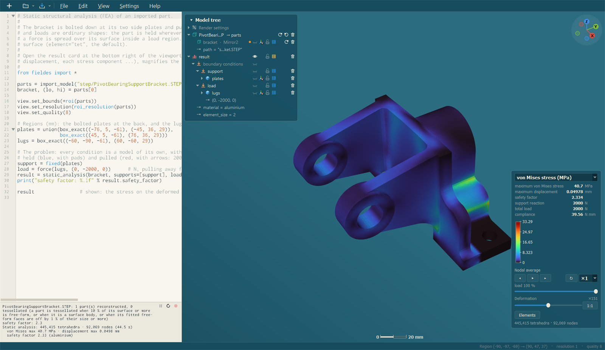
</p>

**[Static analysis](examples/05_static_analysis.py)** — the bracket is bolted at its back plates and pulled at its lugs with 2 kN; the tetrahedra follow its surface (445 000 of them, solved in under a minute).
The result card prints the key numbers (maximum stress, displacement, **safety factor**, reactions, compliance), switches the field (von Mises, displacement, every stress component, principal stresses, strain energy),
magnifies the deformation, steps the load and shows the elements. Supports and loads are shapes — a box, a surface you picked on the part, a field — and the **boundary conditions** row of the analysis shows them all on the part.

<p align="center">
  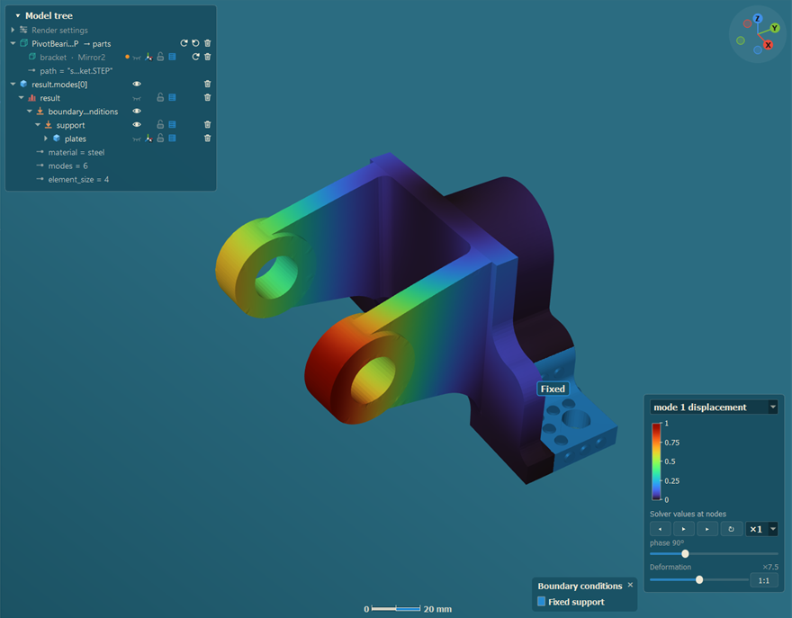
  &nbsp;
  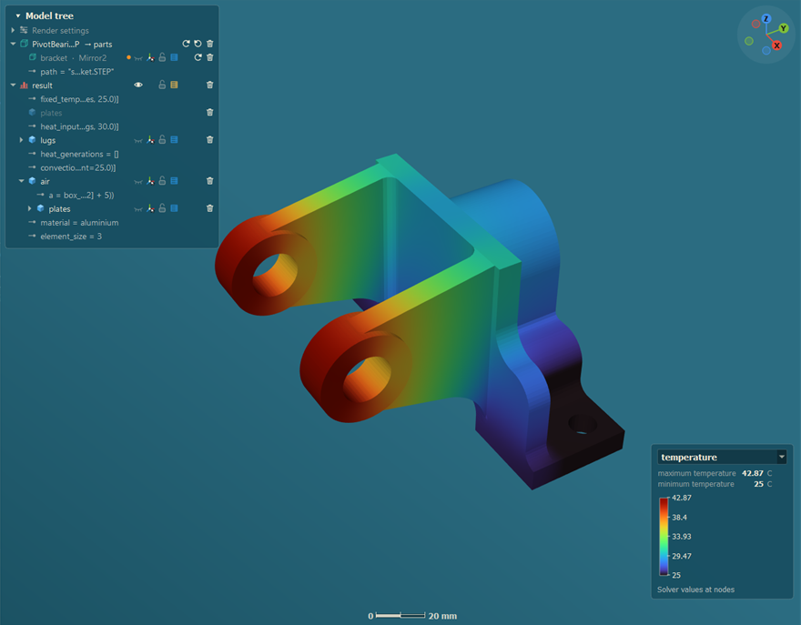
</p>

**[Modal analysis](examples/06_modal_analysis.py)** finds the natural frequencies and mode shapes (every mode is a field; the result card plays the vibration). **[Thermal analysis](examples/07_thermal_analysis.py)**
takes conduction, fixed temperatures, heat inputs and generation, and convection with a coefficient that may itself be a field — and, with the structural analysis, thermal expansion.
Materials and loads can vary through the part: [`19_graded_material.py`](examples/19_graded_material.py) compares a graded beam with beam theory.

### Topology optimisation, with the features that must stay

<p align="center">
  
</p>

**[Topology optimisation](examples/08_topology_optimization.py)** keeps the material that carries the load and removes the rest: the stiffest bracket in half of the material, about 100 iterations, cached
so that running the script again is instant. The lug holes and the ring of material round them are **excluded** from the design space (`exclude(space, holes)`): the optimiser reads an excluded region as one
to keep, and the file's own exact surface is there, whatever is taken away elsewhere. The result on its own is the optimised part coloured by its density; the result card **plays the iterations**, `opt.shape()` is
the final body as a field you can offset, shell or fill with a lattice, and `opt.verify()` analyses it again as a check. There is a thermal version too (`thermal_topology_optimization`), and one for flow (below).

### Let one result drive another design

<p align="center">
  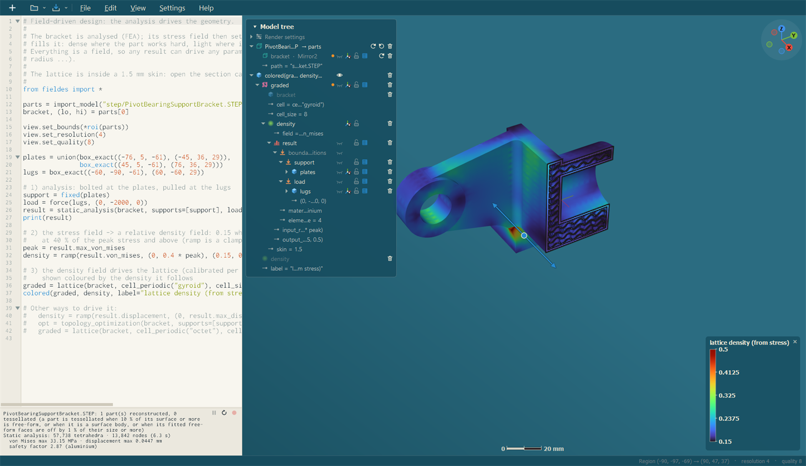
</p>

**[Field-driven design](examples/10_field_driven_design.py)** — the stress of the analysis above becomes the **relative density of a gyroid lattice** that fills the bracket inside a solid skin: dense where the part works
hard, light where it does not. Nothing is sampled onto a grid: the lattice is calibrated per point from the field. Any result can drive any parameter — a wall thickness, a cell size, a blend radius, a spacing.

### Flow, and a body reshaped by the flow

<p align="center">
  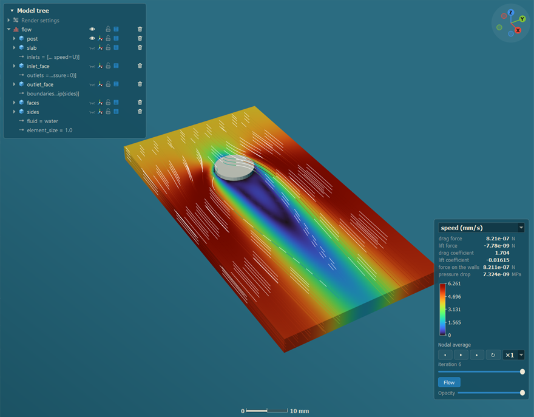
  &nbsp;
  
</p>

**[Fluid flow](examples/16_fluid_flow.py)** solves the laminar Navier–Stokes equations around any body (steady, or in time) on tetrahedra that follow the fluid's surface: inlets, outlets, walls and slip planes are
regions, and the results are the velocity, pressure, vorticity and shear rate **as fields**, with streamlines and moving particles, the wake, the **drag and lift forces and coefficients** and the pressure drop on the card.
**[Flow topology optimisation](examples/17_flow_topology_optimization.py)** reshapes a body in the stream for the least drag or the most lift with its volume bound, from a level set and the solver's exact adjoint:
the body may shrink, grow, move, split or merge, and the card steps through the iterations.

### Lattices that follow the part

<p align="center">
  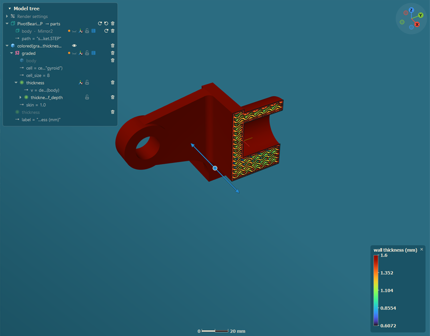
  &nbsp;
  
</p>

[`09_lattice.py`](examples/09_lattice.py) grades a gyroid's wall by a **regression through a few data points** over the depth below the skin; [`15_conformal_closed_body.py`](examples/15_conformal_closed_body.py) lays strut cells that
**follow the surface** of a whole bracket — over its faces, fillets and bores — with a row of nodes on every sharp edge. Foams are made around `random_points` (drawn in the viewport: how far apart, how random, the nearest and the farthest two may be) with `voronoi_lattice` and `delaunay_lattice`.

<p align="center">
  
</p>

[`23_lattice_gallery.py`](examples/23_lattice_gallery.py) shows one lattice of every kind, each in a simple body of its own (no part needed): struts and a custom cell, TPMS sheets and networks, a honeycomb, three foams, a wall graded by a field, a conformal layer and a cell map.

### Results are fields, and the tree reads like the code

<p align="center">
  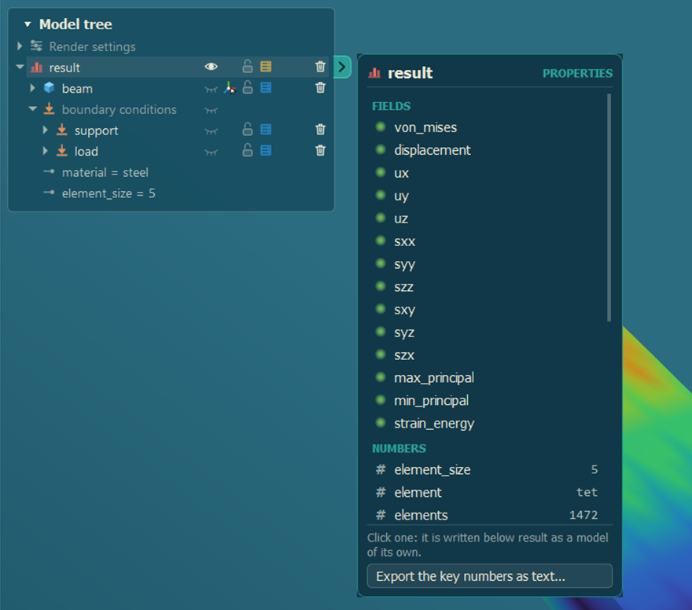
  &nbsp;
  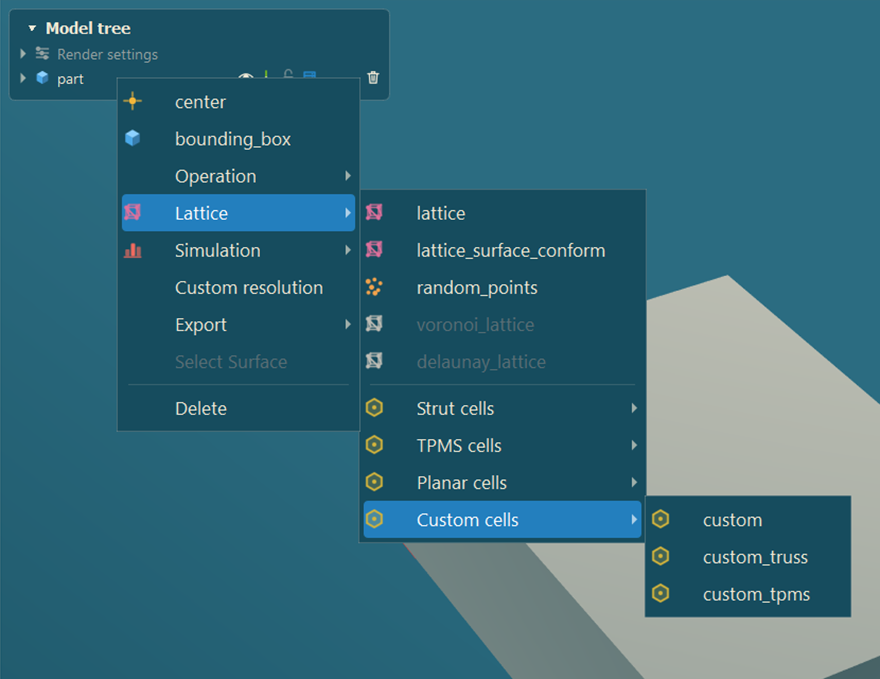
</p>

Point at a result in the model tree and a **tab comes out of the tree's edge**: click it, then a field or a number, and `von_mises_1 = result.von_mises` is written under the analysis — a field like any other, shown in the field viewer,
sliced, used in other models; the drawer's last button writes the **key numbers as a text file**. Every field a solver calculates is a field, not a body. The tree also shows the **arguments** of every call as rows, **sections** you
start by clicking the gap between two rows (they fold in the code editor too), and a **Lattice** menu with every cell. And you can take the results out: `export_fea` hands a static analysis to Abaqus / CalculiX, Nastran or Gmsh,
`export_results` writes VTK, CSV and text, `export_mesh` writes STL, OBJ, PLY, 3MF, glTF, FBX, OFF and DXF ([`22_export_files.py`](examples/22_export_files.py)).

## Quick start

1. **Nothing else has to be installed**: Qt, Python and every library FielDes needs are inside the package, on every platform.
   - **Windows**: run the **installer** of the release (`FielDes-<version>-windows-x64-setup.exe`: it asks for the language, installs for your user without administrator
     rights, makes the Start menu shortcut, and starts FielDes when you click Finish), **or** unzip the portable folder anywhere and run `FielDes.exe` (or build it yourself with
     `scripts/build-windows.ps1 -Package`, see [Building](docs/building.md)).
   - **Linux**: `sh FielDes-<version>-linux-x64-installer.run` installs for you into `~/.local/share/FielDes` with a menu entry and the command `fieldes` (`--system` for everyone; `--uninstall` removes it);
     on Debian and Ubuntu `sudo apt install ./FielDes_<version>_amd64.deb`; or unpack the `.tar.gz` and run `FielDes`.
   - There is no macOS version.

   FielDes speaks English, Spanish, French, German, Japanese, Chinese and Russian (the language of the system by default; **Settings → Language**).
2. The **guided tour** (a welcome card offers it the first time; later **Help → Guided tour**) walks through the basics; **File → Import model…** (`Ctrl+I`) brings in a STEP
   file; or open a script from `examples/` (every one runs as it is: the bracket that comes with FielDes, or geometry the script makes).
3. Right-click empty space to make a shape; click a row in the model tree and drag the gizmo; open the section card
   (`Shift+X`); hover the model.
4. `Shift+F1` opens the guide with every feature and shortcut; `F1` the shape reference.

The smallest script:

```python
from fieldes import *

view.set_bounds([-35, -25, -8], [35, 25, 30], auto_scale=True)    # the region the viewport meshes
view.set_resolution(6)                           # samples per mm
view.set_quality(8)

plate   = box((-30, -20, 0), (30, 20, var(6)))        # var(...): a number you can drag in the viewport
anchor  = point(20, 10, 6)                                    # a point is a model, and a value where a coordinate goes
swell   = ramp(distance_to_point(anchor), (0, 45), (3.0, 0.5))   # 3 mm at the anchor, 0.5 mm 45 mm away: a field
offset(plate, swell)                                          # a field where a number goes
```

The last expression is what is shown; assign other shapes to names and they appear in the model tree.

<p align="center">
  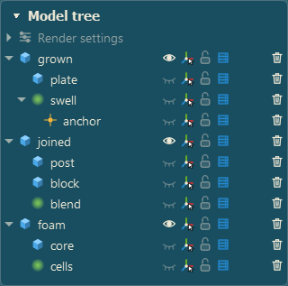
  &nbsp;&nbsp;&nbsp;
  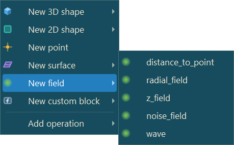
</p>

## Examples

**Every example runs as it is.** Examples 01–13 and 15 start from **the sample part that comes with FielDes**, the pivot-bearing support bracket
(`examples/step/PivotBearingSupportBracket.STEP`, a GrabCAD download distributed at the maintainer's decision, see [NOTICE.md](NOTICE.md)); **examples 14, 16–23 and 25–33 make their own geometry** (24 is an app: its form asks for a model file). To try one on a STEP
file of your own, put it in `examples/step/` and change the path in the script (and the numbers that place the regions: see [`examples/step/README.md`](examples/step/README.md)). The first import of a file
takes a few seconds and is cached next to it.

| Example | Shows |
|---|---|
| [`01_import_a_part.py`](examples/01_import_a_part.py) | Importing, the view settings, mass properties |
| [`02_inspect_a_part.py`](examples/02_inspect_a_part.py) | Wall thickness, overhang, curvature and depth fields; probing; sections |
| [`03_exclude_and_assembly.py`](examples/03_exclude_and_assembly.py) | An assembly of imported parts; `exclude()` with a field object as the region: the STEP file's own surface where it matters |
| [`04_handles.py`](examples/04_handles.py) | The gizmo (its click / never / always modes), dragging surfaces, and the lock |
| [`05_static_analysis.py`](examples/05_static_analysis.py) | Static FEA: supports, loads, results card |
| [`06_modal_analysis.py`](examples/06_modal_analysis.py) | Natural frequencies and mode shapes |
| [`07_thermal_analysis.py`](examples/07_thermal_analysis.py) | Conduction and convection |
| [`08_topology_optimization.py`](examples/08_topology_optimization.py) | The stiffest part in 50 % of the material, with the lug holes excluded so that they stay |
| [`09_lattice.py`](examples/09_lattice.py) | A gyroid graded by a regression over depth |
| [`10_field_driven_design.py`](examples/10_field_driven_design.py) | Stress field → lattice density |
| [`11_custom_lattice.py`](examples/11_custom_lattice.py) | Custom strut cell and TPMS equation |
| [`12_mesh_export_and_import.py`](examples/12_mesh_export_and_import.py) | STL out and back in |
| [`13_tessellated_import.py`](examples/13_tessellated_import.py) | A STEP part imported exactly, nothing fitted; an exact shell and offset of it |
| [`14_conformal_lattice.py`](examples/14_conformal_lattice.py) | A lattice of a custom cell (`cell_custom_truss`) that follows an open surface |
| [`15_conformal_closed_body.py`](examples/15_conformal_closed_body.py) | A conformal strut lattice filling the wall of a whole bracket: faces, fillets, bores, edges followed |
| [`16_fluid_flow.py`](examples/16_fluid_flow.py) | Water past a round post in a channel: the velocity field and the wake, streamlines with moving particles, the drag; the flow in time as an option |
| [`17_flow_topology_optimization.py`](examples/17_flow_topology_optimization.py) | The channel through a block with the least pressure drop |
| [`18_fields_everywhere.py`](examples/18_fields_everywhere.py) | A plate grown by a field, a blend whose radius varies, a lattice of graded cell size — driven from a point |
| [`19_graded_material.py`](examples/19_graded_material.py) | A material whose stiffness varies and a load spread by a profile, against beam theory |
| [`20_custom_blocks.py`](examples/20_custom_blocks.py) | Your own blocks: `perforate` with a field radius, `bracket` |
| [`21_low_level.py`](examples/21_low_level.py) | Low-level fields, as in libfive's Scheme `define-shape` / `remap-shape`: a cube from six plane distances, a twist by a remap, a ball and a torus from their formulas, a gyroid |
| [`22_export_files.py`](examples/22_export_files.py) | Exporting: every mesh format, FEA decks, the results as VTK, CSV and text |
| [`23_lattice_gallery.py`](examples/23_lattice_gallery.py) | One lattice of every kind in a simple body of its own: struts, TPMS, a honeycomb, foams around random points, a graded wall, a cell map, a conformal layer |
| [`24_app_bracket_maker.py`](examples/24_app_bracket_maker.py) | A FielDes app: a form for someone who never opens the editor (a model file, a mode, a wall thickness, where to save), exported as one `.fieldesapp` |
| [`25_app_beam_load_case.py`](examples/25_app_beam_load_case.py) | A FielDes app with a viewport: the person sets up a load by dragging, then runs the analysis |
| [`26_profiles_and_sweeps.py`](examples/26_profiles_and_sweeps.py) | Shapes made of points: a profile, an extrusion, a line and a sweep |
| [`27_copies_and_linked_copies.py`](examples/27_copies_and_linked_copies.py) | Two kinds of duplicate: a copy, and a linked copy that follows its original |
| [`28_profile_on_a_plane.py`](examples/28_profile_on_a_plane.py) | A profile in a plane of its own: the work plane |
| [`29_symmetry.py`](examples/29_symmetry.py) | A symmetry as a model of the script: a round table with three curved legs, one of them drawn |
| [`30_noise_kinds.py`](examples/30_noise_kinds.py) | Noise, one of every kind, and what scale, octaves, stretch and warp do to it |
| [`31_texture.py`](examples/31_texture.py) | A pattern of small bumps and pits laid over the surface of a body: grit, stipple, leather, ribs, dimples, knurl |
| [`32_parametric_optimization.py`](examples/32_parametric_optimization.py) | The lightest beam that is stiff and strong enough, found by solving it again with other numbers |
| [`33_manufacturing.py`](examples/33_manufacturing.py) | What a printer cannot make of a part, where, and the part changed so that it can |

## Documentation

| | |
|---|---|
| [Tutorial](docs/tutorial.md) | The idea, the window, the controls that matter, in a short walk |
| [Getting started](docs/getting-started.md) | Install, first script, a tour of the window |
| [The interface](docs/interface.md) | Top bar, editor, viewport, the typed and nested model tree, drag and drop, section card, result card, shortcuts |
| [Scripting](docs/scripting.md) | Shapes, fields, `var()`, view settings, what gets displayed |
| [Fields and regressions](docs/fields.md) | **Fields everywhere**, points and surfaces, distance fields, maps, `fit()`, coloring |
| [Custom blocks](docs/blocks.md) | Your own functions, in every script |
| [Apps](docs/apps.md) | A script as a program for other people: inputs, the form, `.fieldesapp`, `FielDes run`, watch |
| [Importing STEP files](docs/step-import.md) | Reconstruction, B-spline fits, `exclude()`, `auto_exclude`, the tessellated importer, assemblies, units, caches |
| [Handles](docs/handles.md) | The gizmo, the handles on the surfaces, `gizmo()` and `handles()`, reimport |
| [The symmetry](docs/interface.md#the-symmetry) | A symmetry is a model of the script -- mirror planes through a centre (`symmetry_planes`); select it and everything you make is made at its images too (`symmetry_images`: all the images of a model are one model), which follow both the model and the symmetry; `Shift+S` |
| [Profiles, lines and extrusions](docs/profiles.md) | Shapes made of points: `profile`, `polyline`, `spline`, `extrude`, `path_extrude`; pull a point out of an edge, double-click a point for a spline, rotate and scale a point to shape the curve and the sweep |
| [Analysis](docs/analysis.md) | Static, modal, thermal, thermal stress, topology optimization, fields in analyses; seeing the boundary conditions |
| [Manufacturing](docs/manufacturing.md) | The rules of a process, the check, the shell that changes the part, supports and the files of a print, what it costs and what it does not do |
| [Selecting surfaces](docs/selecting-surfaces.md) | Right-click a face: a flood-filled surface as a field, for supports, loads and lattices |
| [Lattices](docs/lattices.md) | Every lattice type and parameter |
| [Meshes](docs/meshes.md) | Mesh import, STL export |
| [Caching and performance](docs/caching-and-performance.md) | What is cached, resolution and quality, long renders |
| [Troubleshooting](docs/troubleshooting.md) | Empty viewport, slow renders, import and analysis errors |
| [Library reference](docs/reference.md) | Every function and class, from its docstring |
| [Architecture](docs/architecture.md) | How the kernel, the Python library and the application fit together |
| [Building from source](docs/building.md) | Windows build with MSVC and vcpkg; making the portable folder |

## Known limitations

What is a rough edge rather than a limit of the design is in [KNOWN_ISSUES.md](KNOWN_ISSUES.md); **Help ▸ Report a bug** opens a new issue with your version and system filled in.

- **Free-form faces are fitted, not exact, in the field.** The importer rebuilds B-spline faces as
  closed-form surfaces (planes, quadrics, extrusions, revolutions, helices, fillets); where that is poor
  the import says so and colours it, and `exclude()` / `auto_exclude` put the real surface there as a locked
  field (made from a mesh of the STEP file). Outside the region the field stays the fitted one.
- **Tori are not refined in the exact mesh:** a large torus face can come out a few percent small in the
  `exclude()` / `auto_exclude` surface (up to −8 % volume on the worst test part). The field has tori exact.
- **An excluded STEP part's locked field is a mesh's distance**, made when the script runs (the tessellation of the
  part, once; kept while the script is run again). Dragging a `var()` that its region or placement uses updates it
  when the drag ends.
- **Fields as material properties and loads work with the tetrahedral elements**; the voxel elements and the flow solver take
  numbers (they say so when given a field). A graded lattice cell size changes by at most a factor of 16 over the part.
- Windows is the main platform (its package is checked to need nothing but Windows itself). **Linux**: `scripts/build-linux.sh --package` makes a folder that opens with nothing installed
  (Qt, Python and every library inside; only the C library, the graphics driver and X11 of the machine are used), an installer (`.run`) and a `.deb` (see [Building](docs/building.md)). The packages of a
  release are built on Ubuntu 22.04 (glibc 2.35), so they open on Ubuntu 22.04, Debian 12 and everything newer; they were tried under WSL2 + WSLg.
- Units: STEP units are read and converted; STL/OBJ/PLY/OFF carry none and are assumed to be millimetres
  (`file_units=`).
- Analyses are linear (small strain, linear material) and use tetrahedra (or voxel hexahedra); no contact.
- **Not validated for safety-critical use.** FielDes is a design tool, not a certified solver. Four known-answer checks (a beam, a plate with a hole, a channel flow, conduction through a bar) are in
  `examples/verification/` and described in [Verification](docs/analysis.md#verification-four-known-answers): the result card says it too. Compare any result with a hand calculation and a test.

## Project layout

```
kernel/       the C++ kernel: field evaluation, meshing, STEP import, analysis  (fieldes.dll)
python/       the Python library  (import fieldes)
app/          the Qt application  (FielDes.exe)
blocks/       the custom blocks folder: sample blocks, and where yours go
examples/     example scripts and the STEP files they import
docs/         documentation
scripts/      build script, headless runner, reference generator
```

## Credits and licence

FielDes was created by its author ([Tinomart](https://github.com/Tinomart)) **with the help of Claude Code**
(Anthropic's AI coding assistant): the author set the direction and the design, tested the result and decided what
stays; much of the code was written together with Claude Code.

FielDes stands on **libfive** by Matt Keeter ([github.com/libfive/libfive](https://github.com/libfive/libfive)):
its kernel (`kernel/`, namespace `libfive`) and Python bindings (`python/`) are under the
**Mozilla Public License 2.0** (`LICENSE-MPL-2.0`), and the application (`app/`) derives from its
**Studio** GUI and is under the **GNU General Public License, version 2 or later** (`LICENSE-GPL-2.0`).
Files added for FielDes carry the licence of the part they belong to. See [`NOTICE.md`](NOTICE.md) for the
list of third-party components (Qt, Eigen, Boost, Manifold, libpng, Python, the Inconsolata font).
